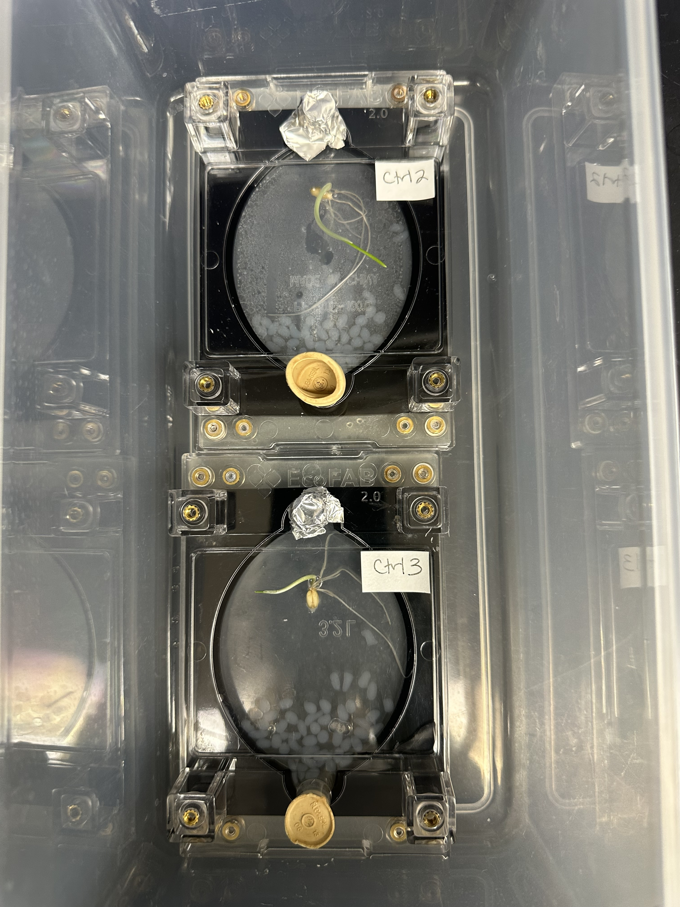
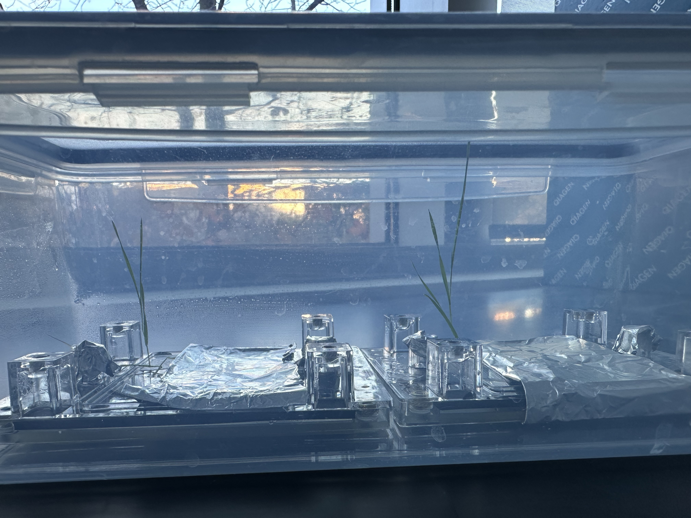
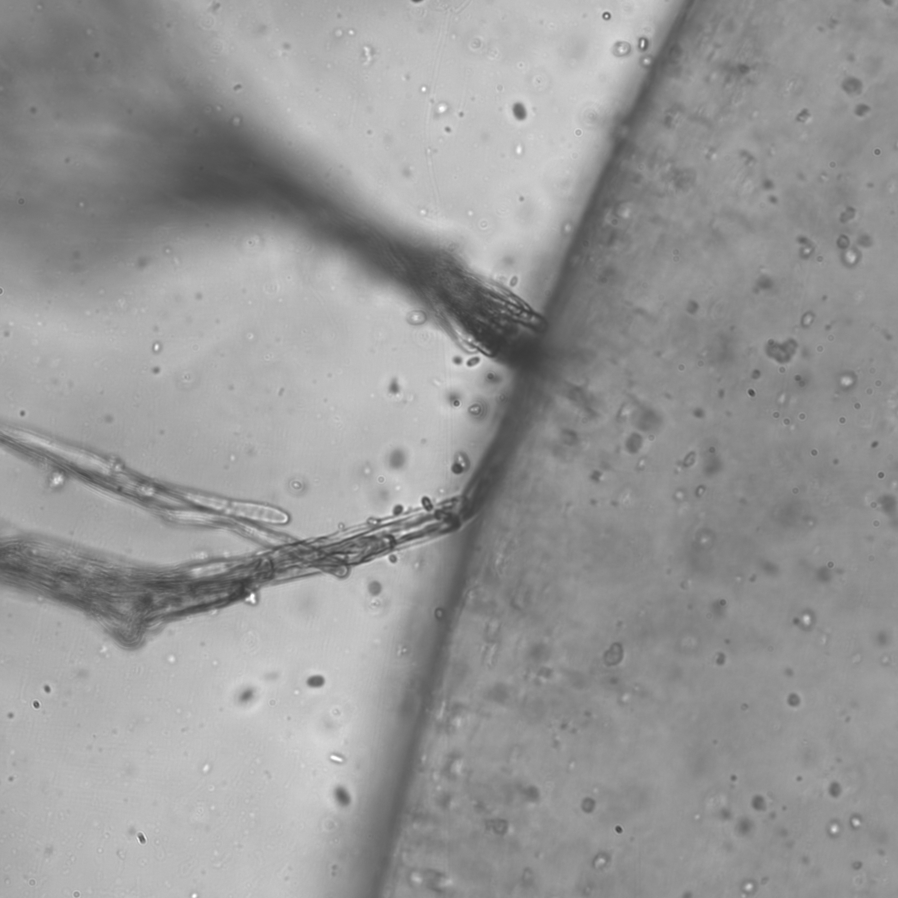
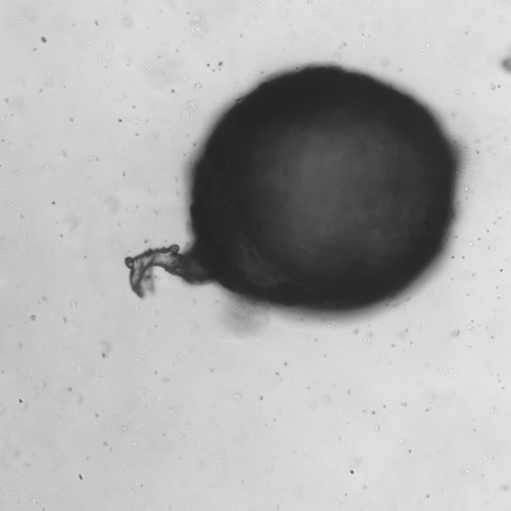
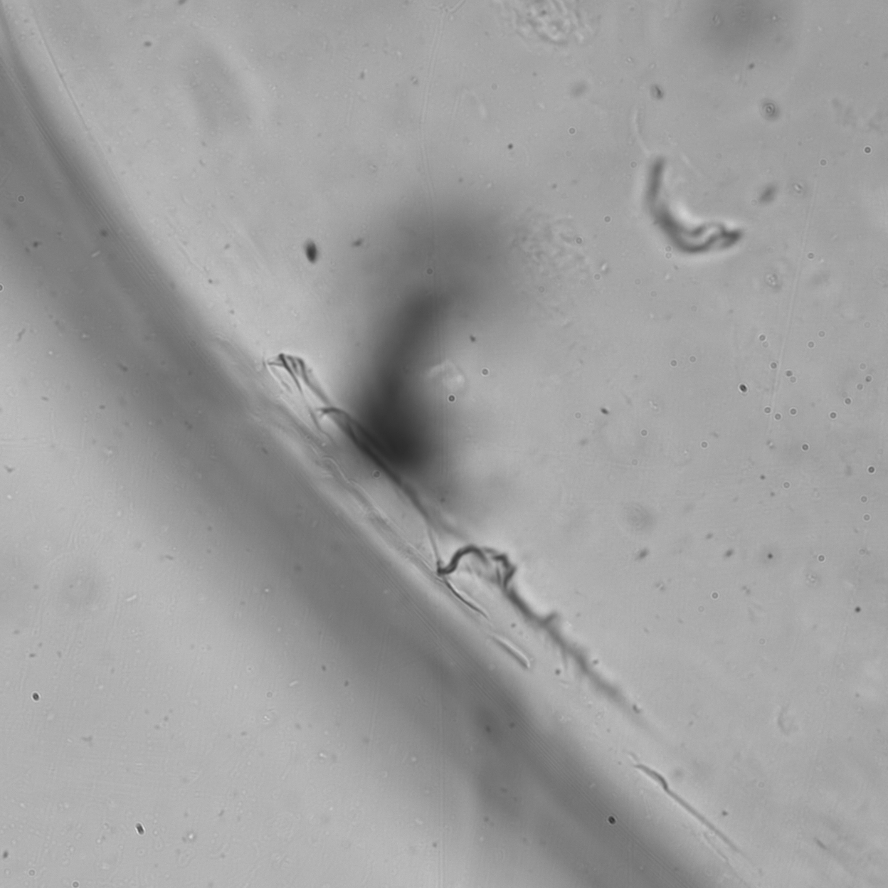
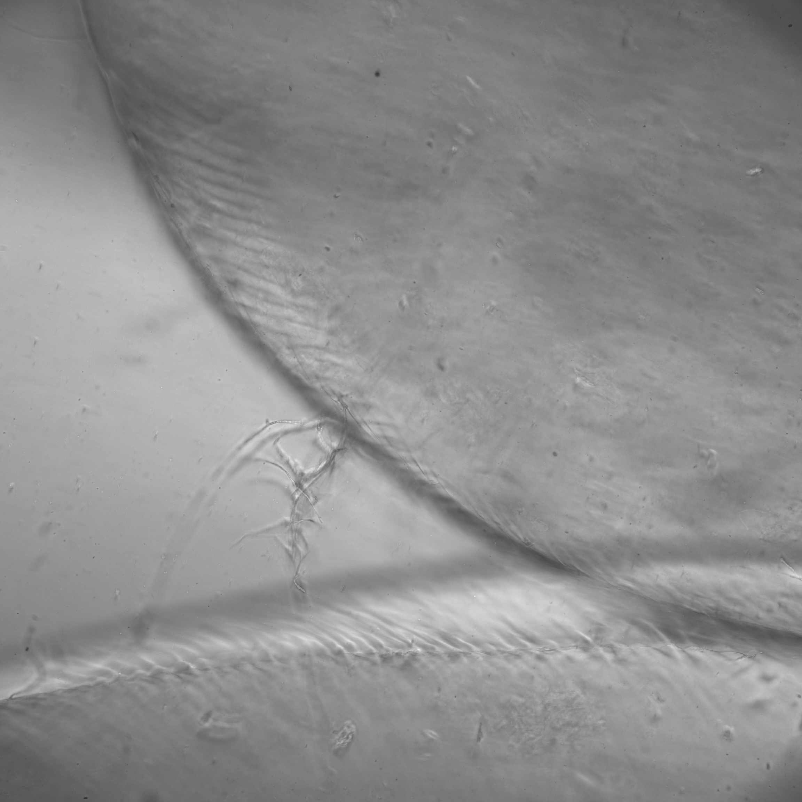

# Introduction

Biological nitrogen fixation (BNF) is a process by which microbes process biologically-available nitrogen (N) from atmospheric nitrogen ($N_{2}$). $N_{2}$ is an inert gas and unavailable for direct plant uptake. In BNF, either symbiotic or free living microbes convert atmospheric $N_{2}$ to $NH_{3}$. This is further nitrified into $NO_{3}-$ and $NH_{4}+$, which can be taken up by plant roots and arbuscular mycorrhizal fungi (AMF). About 50% of the global N budget can be attributed to BNF (Chalk 2016), rendering this an important process for N cycling and and agricultural productivity. Stable isotopes like $^{15}N_{2}$ can be used to trace N movement through soil, microbial, and plant systems.

N-fixing bacteria can be classified as either symbiotic (residing in root nodules) or free living in the rhizosphere. Common free living N-fixers include *Azotobacter vinelandii* and *Azospirillium brasilense*, which have been shown to increase plant root growth and nitrogen uptake (Santi et al, 2013). AMF are plant root mutualists and enhance N uptake to the plant, possessing genes of primary N assimilation and catabolism (nitrate reductase, glutamine synthetase and glutamate dehydrogenase, Pfeffer et al, 2005). They also contribute to bacterial-fungi interactions with rhizospheric bacteria, as they offer microniches for bacteria to inhabit and act as 'superhighways' for them. Bacteria alter soil composition and engage in signaling which affect AMF communities (Deveau et al, 2018)

EcoFABs (fabricated ecosystems) are bench scale models designed to observe these types of rhizophere interactions. They have been previously used for microbial compatibility testing in BioBead (Mafune et al, 2024) and are well-suited for studying plant root, microbial, mycorrhizal fungal interactions. This study will address $^{15}N_{2}$ movement from the atmosphere to soil microorganisms to a plant host. A previous pilot trial (Davis, 2025) demonstrated that wheat plants (*Triticum aestivum*) grow poorly in the EcoFAB chambers. This follow up study will use the model plant *Brachypodium distachyon* with BioBeads treated with microbial consortia with strong N fixation capabilities. In this study, the air around *Brachypodium distachyon* plants will be enriched with $^{15}N_{2}$ for short period of time. The tissues will be analyzed for $^{15}N$ content relative to $^{14}N$ ($\delta^{15}N$). This information will provide insight on the N fixing capabilities of BioBead hydrogels containing microbial consortia. The null hypothesis is that there is no difference in mean $\delta^{15}N$ content between the BioBead and control plants. The alternative hypothesis is that there is a difference in mean $\delta^{15}N$ content between the BioBead and control plants.

# Materials and Methods

## Experimental Design

To evaluate the effects of microbial inoculation on plant growth and nitrogen fixation, we prepared two types of hydrogel beads: BioBeads, containing a mix of arbuscular mycorrhizal fungi (AMF), *Azospirillum brasilense*, and *Azotobacter vinelandii*, and control beads, which lacked microbial inoculation. A total of 50 mL of each bead type was produced for the experiment according to methods in Mafune et al (2024).

Six EcoFAB 2.0 units were placed into 3 plant growth chambers. Each chamber lid was modified by drilling a single hole using a drill press and a 7/18” drill bit, into which a 20 mm rubber butyl stopper was inserted. Since each chamber could accommodate 2 EcoFAB 2.0 units, each BioBead unit was paired with a control to mitigate environmental effects.

**Seed Preparation and Germination**\
*Brachypodium distachyon* seeds were surface sterilized by submerging them in 70% ethanol for 1 minute, followed by a 5-minute immersion in chloramine T. The seeds were then rinsed 10 times with MilliQ water to remove any residual sterilant. To promote uniform germination, the sterilized seeds were placed on a 1.7% agar plate and cold-stratified at 4°C for 48 hours before being incubated at 20°C until germination was observed.

**EcoFAB Assembly and Inoculation**\
Prior to inoculation, the EcoFABs were assembled and bleach-sterilized to minimize contamination. Under sterile conditions, each EcoFAB was filled with 7 mL of 0.5× Murashige & Skoog (MS) medium without nitrate. Approximately 40–50 beads (either BioBeads or control beads) were added to the bottom of the sampling port, which was then covered with sterilized tinfoil. The EcoFABs were incubated at 20°C with a 12-hour light/12-hour dark photoperiod inside clean tote bins. Liquid media was refreshed weekly by adding 2 mL of 0.5× MS medium.

$^{15}N_{2}$ Contaminant Screening 

To screen for potential ammonium contaminants (2014 ref), 30mL of the $^{15}N_{2}$ gas was acid-washed with 10mL of 1N hydrochloric acid (Doty et al., 2016) in a Balch tube, agitated for 180 seconds, neutralized to pH 6 and screened in the Gallery analyzer (ThermoFischer). This test was performed in triplicate.

$$NH_{4}^{+} + HCl = NH_{4}Cl + H{+}$$

The concentration of $N_{2}$ is 0.134M:

$$\frac{0.03L}{224L/mol}=\frac{0.00134 mol N_{2}/30mL}{0.010L HCl}=0.134M$$ The instrument did not detect any $NH_{4}+$ (LOD 0.1 uM). This means that an $NH_{4}+$ contaminant, if present, would be below 0.0000746% or 1.8 ppb.

Sterile tinfoil was used to cover sampling ports as well as the root viewing pane to prevent any potential light damage to the study organisms.

**Nitrogen Enrichment and Sample Processing**\
At six weeks post-inoculation, N enrichment was introduced by adding 60 mL of $^{15}N_{2}$ gas (98% purity, Cambridge Isotopes) to each container to achieve a 2% enrichment level (see Dosing Rationale below). The container lids were sealed with vacuum grease for a one-week exposure period.

The following week, the dosing was repeated but with a gradient:

-   BioBead 1 and Ctrl 1: 60 mL

-   BioBead 2 and Ctrl 2: 30 mL

-   BioBead 3 and Ctrl 3: 0 mL

{width="350"}

**Isotopic Mass Spectroscopy**

At the end of the experiment, the entire plant (roots and above-ground biomass) were harvested and dried at 60°C for 72 hours. Elemental analyses and isotope composition were obtained from powdered biomass by using an isotope ratio-monitoring mass spectrometer (the EA-ConfloII-Delta XL Plus system) followed by a C and N elemental analyzer.

{width="350"}

{width="350"}

## Data Collection

Isotopic compositions are reported in $^{15}N$ values referenced to the stable N isotope composition of $N_{2}$ in air. The $^{15}N$ values are calculated using the following equation,

$\delta^{15}N=(R_{sa}/R_{std}-1)*1,000(‰),$

where $R_{std}$ and $R_{sa}$ are the $^{15}N$/$^{14}N$ ratios of the standard and sample (Filley et al., 2001).

# $^{15}N_{2}$ dosing rationale

For $^{15}N_{2}$ enrichment dosing, other research groups have used simple calculations of chamber volume or headspace percentage. Examples include 20% of atmosphere (Alexander 1989), 10% vol of chamber (Martinez-Feria et al., 2024), or 1% spike of headspace or chamber (Doty et al., 2016) without replacement. One study (Smercina 2019) used a different approach with pN2 1.87 atm. Wewalwela (2020) used 5% $^{15}N_{2}$ enrichment. We chose 2% as an enrichment target for the EcoFAB experiments.

The ideal gas law frames the relationships between pressure, volume, temperature and moles of gas. $${PV = nRT}$$ $$n=\frac{PV}{RT}$$ The ideal gas law allows calculations of moles of gas for the given 2.945L container housing EcoFABs. $$n=\frac{PV}{RT}=\frac{1 atm \times2.945L}{0.0821 \frac{L\times atm}{mol \times K} \times 298K}=0.121mol$$ Another calculation corrects the number of moles for 2% enrichment at 98% purity. $$0.02 \times 0.121 mol ^15N2 =\frac{0.0061mol^15N2}{0.98}=0.0062mol^15N2$$ Using the ideal gas law, we can now use the new mole parameter to find the volume (and account for the mole fraction of nitrogen gas in air). $$V=\frac{nRT}{P}=\frac{0.0062mol \times 0.0821 \frac{L\times atm}{mol \times K}\times 298K}{ 1 atm} \times {0.78}=0.120L$$

# Observations

## Slow early growth and nitrate supplementation

The seedlings showed slow early growth, including yellowing of leaves. To maintain plant health, 100 $\mu$L of $NH_{4}NO_{3}$ (825 mg/L) was added to each EcoFAB at week 2.

## Confocal microscopy

A Yokogawa CSU-X1 spinning disk confocal microscope was used to image the hydrogel beads, roots, and media at week 10.

{width="350"}

{width="350"}

The micrographs from the BioBead units are teeming with life. Microbes can be seen in the media. Hyphae penetrate beads and roots.

{width="350"}

{width="350"}

# Results

## Ammonium concentrations in media over time

```{r echo=TRUE}
library(ggplot2)

# data entry
BioBead1 <- c(143.54,31.65,156.36,39.97,42.24,107.87,65.40,58.40,48.91,42.27,136.03)
BioBead2 <- c(44.64,32.61,0,0,0,0,0,0,0,0,21.77)
BioBead3 <- c(21.04,17.12,27.11,28.62,32.43,76.64,46.13,70.80,36.8,21.57,516.56) #note: last data point may be an outlier

Ctrl1 <- c(308.51,176.63,28.71,104.38,12.81,15.58,8.92,12.34,9.68,13.72,1.35)
Ctrl2 <- c(318.96,347.62,303.56,42.55,39.44,36.98,15.33,7.1,5.6,9.45,15.26)
Ctrl3 <- c(149.86,155.22,159.93,50.81,106.48,41.01,13.59,13.48,7.02,0,10.34)

MSmedia <- c(42.75,42.75,42.75,42.75,42.75,42.75,42.75,42.75,42.75,42.75,42.75)

# Creating the data frame with explicit week assignments
data <- data.frame(
  Week = rep(1:11, 7),  # Repeating weeks for each treatment
  Treatment = rep(c("BioBead1", "BioBead2", "BioBead3", "Ctrl1", "Ctrl2", "Ctrl3", "MSmedia"), each = 11),
  NH4_Concentration = c(BioBead1, BioBead2, BioBead3, Ctrl1, Ctrl2, Ctrl3, MSmedia)
)

# Define custom colors
treatment_colors <- c("BioBead1" = "red", "BioBead2" = "orange", "BioBead3" = "yellow", 
                      "Ctrl1" = "green", "Ctrl2" = "blue", "Ctrl3" = "purple", 
                      "MSmedia" = "gray")

# Creating the line plot
ggplot(data, aes(x = Week, y = NH4_Concentration, group = Treatment, color = Treatment)) +
  geom_line(size = 1) +
  geom_point(size = 3) +
  scale_color_manual(values = treatment_colors) +
  labs(title = "NH4+ concentrations over time",
       x = "Week",
       y = "NH4+ concentrations (mg/L)") +
  theme_minimal() +
  theme(plot.title = element_text(hjust = 0.5, face = "bold"))
```

There is also total organic nitrogen data that may be analyzed at a later date as well. The values are all negative, and do not fluctuate very much.

## Bead and root imaging

At the end of experiment, the hydrogel beads and roots from each EcoFAB were stained according to methods published in Mafune, Kasson, and Winkler (2024): "B. distachyon plants were removed through the seed port and roots were set aside for clearing and staining techniques to observe any mycorrhizal establishment in fine roots. The roots were cleared and stained using modified methods from Phillips and Hayman (1970), which included a KOH concentration of 8% (w/v)...Then, roots were acidified in 2% HCl for 10 min, soaked for 6 h in 0.05% Trypan Blue in lactoglycerol, and finally destained in MilliQ H2O for 18–24 h to remove excess dye (Phillips and Hayman 1970). Samples from each EcoFAB were kept separate and observed under the Leica EZ4D dissecting scope for staining patterns." (5% KOH w/v was used in this experiment).

## d15N concentrations

To be analyzed by the University of Oklahoma Stable Isotope Lab in May 2025.

# References

Alexander DB, Zuberer DA. 1989. 15N2 Fixation by Bacteria Associated with Maize Roots at a Low Partial 02 Pressure. APPL ENVIRON MICROBIOL. 55.

Chalk PM, Lam SK, Chen D. 2016. 15N methodologies for quantifying the response of N2-fixing associations to elevated [CO2]: A review. Science of The Total Environment. 571:624–632. [doi:[10.1016/j.scitotenv.2016.07.030](doi:%5B10.1016/j.scitotenv.2016.07.030){.uri}](https://doi.org/10.1016/j.scitotenv.2016.07.030).

Chalk PM, Craswell ET. 2018. An overview of the role and significance of 15N methodologies in quantifying biological N2 fixation (BNF) and BNF dynamics in agro-ecosystems. Symbiosis. 75(1):1–16. [doi:[10.1007/s13199-017-0526-z](doi:%5B10.1007/s13199-017-0526-z){.uri}](https://doi.org/10.1007/s13199-017-0526-z).

Davis, R. 2025. EcoFAB pilot study in wheat plants. Unpublished.

Deveau A, Bonito G, Uehling J, Paoletti M, Becker M, Bindschedler S, Hacquard S, Hervé V, Labbé J, Lastovetsky OA, et al. 2018. Bacterial–fungal interactions: ecology, mechanisms and challenges. FEMS Microbiology Reviews. 42(3):335–352. <doi:10.1093/femsre/fuy008>.

Filley TR, Blanchette RA, Simpson E, Fogel ML. 2001. Nitrogen cycling by wood decomposing soft-rot fungi in the “King Midas tomb,” Gordion, Turkey. Proceedings of the National Academy of Sciences. 98(23):13346–13350. [doi:[10.1073/pnas.221299598](doi:%5B10.1073/pnas.221299598){.uri}](https://doi.org/10.1073/pnas.221299598).

Gao, J., Sasse, J., Lewald, K. M., Zhalnina, K., Cornmesser, L. T., Duncombe, T. A., Yoshikuni, Y., Vogel, J. P., Firestone, M. K., Northen, T. R. Ecosystem Fabrication (EcoFAB) Protocols for The Construction of Laboratory Ecosystems Designed to Study Plant-microbe Interactions. J. Vis. Exp. (134), e57170, <doi:10.3791/57170> (2018).

Mafune K, Kasson M, Winkler M-KH. 2024. Building blocks towards sustainable biofertilizers: Variation in arbuscular mycorrhizal spore germination when immobilized with diazotrophic bacteria in biodegradable hydrogel beads. Journal of Applied Microbiology. 135(7). [doi:[10.1093/jambio/lxae167](doi:%5B10.1093/jambio/lxae167){.uri}](https://doi.org/10.1093/jambio/lxae167).

Maher H, Moussadek R, Zouahri A, Douaik A, Amenzou NE, Benmansour M, Iaaich H, Dakak H, El Mouridi Z, Bellaouchou A, et al. Nitrogen Use Efficiency Using the 15N Dilution Technique for Wheat Yield under Conservation Agriculture and Nitrogen Fertilizer. Nitrogen. 2023; 4(4):369-381. <https://doi.org/10.3390/nitrogen4040026>

Pfeffer PE, Jin H, Abubaker J, Douds DD, Allen JW, Bücking H, Lammers PJ, Shachar-Hill Y. 2005. Nitrogen transfer in the arbuscular mycorrhizal symbiosis. Nature. 435(7043):819–823. <doi:10.1038/nature03610>.

Phillips JM, Hayman DS. Improved procedures for clearing roots and staining parasitic and vesicular-arbuscular mycorrhizal fungi for rapid assessment of infection. Trans Br Mycol Soc 1970;55:158IN18. [https://doi.org/10.1016/S0007-1536(70)80110-3](https://doi.org/10.1016/S0007-1536(70)80110-3){.uri}

Santi C, Bogusz D, Franche C. 2013. Biological nitrogen fixation in non-legume plants. Ann Bot. 111(5):743–767. <doi:10.1093/aob/mct048>.

Sasse, J., Kant, J., Cole, B.J., Klein, A.P., Arsova, B., Schlaepfer, P., Gao, J., Lewald, K., Zhalnina, K., Kosina, S., Bowen, B.P., Treen, D., Vogel, J., Visel, A., Watt, M., Dangl, J.L. and Northen, T.R. (2019), Multilab EcoFAB study shows highly reproducible physiology and depletion of soil metabolites by a model grass. New Phytol, 222: 1149-1160. <https://doi.org/10.1111/nph.15662> 

Smercina DN, Evans SE, Friesen ML, Tiemann LK. 2019. Optimization of the 15N2 incorporation and acetylene reduction methods for free-living nitrogen fixation. Plant Soil. 445(1–2):595–611. [doi:[10.1007/s11104-019-04307-3](doi:%5B10.1007/s11104-019-04307-3){.uri}](https://doi.org/10.1007/s11104-019-04307-3). 

Vlastimil Novak et al.,Reproducible growth of Brachypodium in EcoFAB 2.0 reveals that nitrogen form and starvation modulate root exudation.Sci. Adv.10,eadg7888(2024).DOI:10.1126/sciadv.adg7888 

Wewalwela JJ, Tian Y, Donaldson JR, Baldwin BS, Varco JJ, Rushing B, Lu H, Williams MA. 2020. Associative nitrogen fixation linked with three perennial bioenergy grasses in field and greenhouse experiments. GCB Bioenergy. 12(12):1104–1117. [doi:[10.1111/gcbb.12744](doi:%5B10.1111/gcbb.12744){.uri}](https://doi.org/10.1111/gcbb.12744). 
